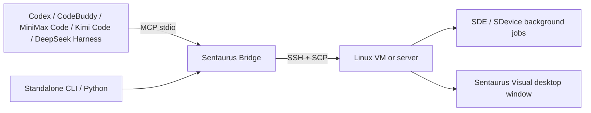

# Sentaurus Bridge Lite

[简体中文](README.md) | **English**

**Connect AI clients and your terminal directly to remote Sentaurus. No VS Code required.**

An editor-independent CLI and MCP bridge for running Synopsys Sentaurus TCAD on a Linux VM or server.

Write models locally, upload them over SSH, run SDE / SDevice, inspect logs and results, and open device structures on the VM's desktop. Use the standalone terminal commands or connect the same tools to Codex, CodeBuddy, MiniMax Code, Kimi Code (with optional K3.1 Pro), the official DeepSeek Harness, or another MCP client.

## Features

- **Connection and diagnostics:** reuse OpenSSH keys, host aliases, jump hosts, and your existing Sentaurus environment.
- **File transfer:** upload inputs, read text files, and download results. MCP file operations enforce the configured workspace boundaries and require an explicit option to overwrite files.
- **Background simulations:** receive a job ID immediately, then check status, exit codes, logs, timeouts, or cancellation. Submitted jobs keep running after the AI client disconnects.
- **Structure visualization:** discover an X11 desktop on the VM and open `.tdr` files in Sentaurus Visual, without a Windows X Server.
- **AI integration:** standard stdio MCP tools and client configuration generators. Your client manages model selection and API keys.



The bridge does not include an AI model or replace Sentaurus. The remote machine needs an existing Synopsys installation and a valid license. VS Code Remote - SSH remains an optional entry point.

## Installation and connection

Your local machine needs **Python 3.10+** and OpenSSH `ssh` / `scp`. Job management, MCP, and desktop features require **Python 3.6+** on remote Linux. The original `run/push/pull` commands continue to use SSH/SCP directly.

```bash
git clone https://github.com/jianshengchuanchaun/sentaurus-bridge-lite.git
cd sentaurus-bridge-lite
python -m pip install -e ".[mcp]"
sentaurus-bridge init
```

Edit the generated `.env`, for example:

```dotenv
SB_REMOTE_HOST=sentaurus-vm
SB_REMOTE_USER=tcad
SB_REMOTE_WORKDIR=~/sentaurus-work
SB_SENTAURUS_ROOT=/opt/synopsys/sentaurus/your-version
SB_SENTAURUS_SETUP=export SNPSLMD_LICENSE_FILE=27000@your-license-server
SB_REMOTE_SHELL=bash
SB_LOGIN_SHELL=0
SB_DESKTOP_USER=tcad
```

`sentaurus-vm` can be a host alias in `~/.ssh/config` or an IP address. Set the installation path and license server for your environment. First run `ssh sentaurus-vm` to verify the host fingerprint and complete key-based login, then run:

```bash
sentaurus-bridge doctor --batch
sentaurus-bridge doctor --json
```

`doctor` checks connectivity and executable paths. **Finding an executable does not verify license availability or simulation convergence.** Run a small model of your own when first setting up the bridge. See [Quick start](QUICKSTART.en.md) and [Troubleshooting](docs/TROUBLESHOOTING.en.md).

## Run without opening an editor

Assume your local `my-nmos` directory contains `sde.scm`, `sdevice.cmd`, and the required material parameters:

```bash
sentaurus-bridge push my-nmos ~/sentaurus-work
sentaurus-bridge job submit -w my-nmos -- sde -e -l sde.scm
sentaurus-bridge job status <SDE_JOB_ID>
sentaurus-bridge job logs <SDE_JOB_ID>
```

After confirming that the mesh was generated, run the device simulation:

```bash
sentaurus-bridge job submit -w my-nmos --timeout 3600 -- sdevice sdevice.cmd
sentaurus-bridge job status <SDEVICE_JOB_ID>
sentaurus-bridge job logs <SDEVICE_JOB_ID>
sentaurus-bridge pull ~/sentaurus-work/my-nmos sentaurus-results
```

Replace `<...>` with the actual returned values. All `job` subcommands output JSON. To stop a job, run `sentaurus-bridge job cancel <JOB_ID>`, then query its status to confirm that it stopped.

## AI clients and model providers

```bash
sentaurus-bridge --env /absolute/path/.env client-config codex --local-root /absolute/path/project
sentaurus-bridge --env /absolute/path/.env client-config codebuddy --local-root /absolute/path/project
sentaurus-bridge --env /absolute/path/.env client-config minimax --local-root /absolute/path/project
sentaurus-bridge --env /absolute/path/.env client-config kimi-code --local-root /absolute/path/project
sentaurus-bridge --env /absolute/path/.env client-config deepseek-harness --local-root /absolute/path/project
```

On Windows, absolute paths such as `C:/TCAD/project/.env` are supported. The generator prints configuration for you to merge; it does not overwrite existing client settings. It uses the current Python interpreter's absolute path so desktop clients can locate it.

| Client / model entry point | Integration | Configuration output |
| --- | --- | --- |
| Codex CLI / desktop app | Local CLI or stdio MCP | `client-config codex` → TOML |
| CodeBuddy Code | stdio MCP | `client-config codebuddy` → JSON |
| MiniMax Code | Project MCP; model selected in the client | `client-config minimax` → JSON |
| **Kimi Code CLI / desktop app** | stdio MCP; K3.1 Pro can be selected in the client | `client-config kimi-code` (alias `kimi`) → JSON |
| **Official DeepSeek Harness (dsh)** | Official `dsh-mcp-client` plugin | `client-config deepseek-harness` → Cordis YAML |
| Claude Code | stdio MCP; model backends such as MiniMax can be configured using the provider's instructions | `client-config claude` → JSON |
| OpenCode | Local MCP; model selected in the client | `client-config opencode` → JSON |
| Other MCP clients | Must support local stdio tool calls | `client-config generic` → JSON |

**The client and the model are separate layers.** Models from MiniMax, Kimi, DeepSeek, and other providers control the bridge through a client capable of executing tool calls. An ordinary web chat does not automatically gain local SSH access. This project does not receive model API keys.

For Kimi Code, merge the configuration into the project's `.kimi-code/mcp.json` or the user-level `~/.kimi-code/mcp.json` (use the `KIMI_CODE_HOME` directory when set). Select **K3.1 Pro** with `/model` in the CLI or the model selector in the desktop app, and keep thinking mode enabled. Model IDs are `k3.1-pro` and `k3.1-pro-highspeed`; availability depends on your account and the [official Kimi model documentation](https://www.kimi.com/code/docs/kimi-code/models.html).

The configuration formats follow the clients' official documentation. This does not mean every model, account, and client version has been tested through real API requests. See [AI client setup](docs/AI_CLIENTS.en.md) and [Validation record](docs/VALIDATION.en.md) for instructions and test coverage.

After connecting, try this prompt:

> Check the Sentaurus connection first. Upload this project's SDE and SDevice inputs into a separate directory and run SDE. Confirm that the mesh exists before running SDevice. Return the job IDs, exit codes, and logs. After successful completion, download the results and open the structure on the VM's desktop.

## View a structure on the VM

```bash
sentaurus-bridge desktop list
sentaurus-bridge desktop open my-nmos/nmos_msh.tdr
```

Log in to the VM's graphical desktop first. Paths are relative to `SB_REMOTE_WORKDIR`, and the desktop user must be able to read the file. If SSH uses root but the desktop belongs to a regular user, use a project directory accessible to both; do not place visualization files under `/root`.

Mesa software rendering is used by default. Add `--no-mesa` to use the default graphics driver. A `launched` result means the launch request succeeded; **it does not verify a visible window, the license, or the structure's contents**. The original `gui --x11` command remains available for setups with a local X Server.

## Configuration and permissions

Configuration precedence is **process environment variables > configuration file**. One configuration file is selected in this order: `--env`, `.env` in the current directory, then `~/.sentaurus-bridge/.env`. Do not commit private `.env` files.

MCP file operations check workspace boundaries. `submit_tool` accepts only tool names listed in `SB_SENTAURUS_TOOLS` and passes arguments literally. However, SDE Scheme, Sentaurus commands, and environment initialization scripts can still execute code: **this is not a remote execution sandbox**. Use an SSH account with appropriate permissions and trusted inputs. Client approval policies remain under the client's control.

Jobs are stored remotely in `<workspace>/.sbridge/jobs/<id>/`, with status and logs retained. The bridge does not automatically retry simulations, clean up results, or restart license services.

## Development

```bash
python -m pip install -e ".[dev]"
python -m pytest -q
```

Tests and CI do not require Synopsys. Real TCAD validation uses private models; their inputs and results are not distributed with the source code. See the [Changelog](CHANGELOG.en.md) for upgrade notes.
