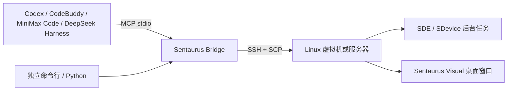

# Sentaurus Bridge Lite

**让 AI 客户端和命令行直接连接远程 Sentaurus。无需 VS Code。**

An editor-independent CLI and MCP bridge for running Synopsys Sentaurus TCAD on a Linux VM or server.

在本机编写模型，通过 SSH 上传到虚拟机，运行 SDE / SDevice，读取日志和结果，再把结构打开到虚拟机桌面。可以使用终端，也可以把同一套工具接到 Codex、CodeBuddy、MiniMax Code、官方 DeepSeek Harness 或其他 MCP 客户端。

## 功能

- **连接与诊断**：复用 OpenSSH 密钥、主机别名、跳板机和已有 Sentaurus 环境。
- **文件往返**：上传输入、读取文本、下载结果；MCP 文件操作检查配置的工作目录边界，覆盖文件需要明确指定。
- **后台仿真**：立即返回任务 ID，支持状态、退出码、日志、超时和取消。关闭 AI 客户端不会中断已提交的任务。
- **查看结构**：发现虚拟机中的 X11 桌面，把 `.tdr` 交给 Sentaurus Visual，无需 Windows X Server。
- **AI 接入**：标准 stdio MCP 工具与客户端配置生成器；模型选择和 API 密钥由客户端管理。



桥接程序不包含大模型，也不替代 Sentaurus。远程机器需要已有可用的 Synopsys 安装与授权。VS Code Remote - SSH 作为可选入口继续保留。

## 安装与连接

本机需要 **Python 3.10+** 和 OpenSSH 的 `ssh` / `scp`。新版任务、MCP 和桌面功能需要远程 Linux 有 **Python 3.6+**；原有 `run/push/pull` 仍直接使用 SSH/SCP。

```bash
git clone https://github.com/jianshengchuanchaun/sentaurus-bridge-lite.git
cd sentaurus-bridge-lite
python -m pip install -e ".[mcp]"
sentaurus-bridge init
```

编辑新建的 `.env`，例如：

```dotenv
SB_REMOTE_HOST=sentaurus-vm
SB_REMOTE_USER=tcad
SB_REMOTE_WORKDIR=~/sentaurus-work
SB_SENTAURUS_ROOT=/opt/synopsys/sentaurus/your-version
SB_SENTAURUS_SETUP=export SNPSLMD_LICENSE_FILE=27000@your-license-server
SB_REMOTE_SHELL=bash
SB_LOGIN_SHELL=0
SB_DESKTOP_USER=tcad
```

`sentaurus-vm` 可以是 `~/.ssh/config` 中的主机别名，也可以换成 IP。按实际安装修改路径和许可服务器。先用 `ssh sentaurus-vm` 核对主机指纹并完成密钥登录，再运行：

```bash
sentaurus-bridge doctor --batch
sentaurus-bridge doctor --json
```

`doctor` 验证连接和程序路径；**找到程序不代表许可证可用或仿真收敛**。首次使用应再运行自己的小型模型。详见 [快速开始](QUICKSTART.md) 和 [故障排查](docs/TROUBLESHOOTING.md)。

## 不打开编辑器也能运行

假设本地 `my-nmos` 中已有 `sde.scm`、`sdevice.cmd` 和材料参数：

```bash
sentaurus-bridge push my-nmos ~/sentaurus-work
sentaurus-bridge job submit -w my-nmos -- sde -e -l sde.scm
sentaurus-bridge job status <SDE_JOB_ID>
sentaurus-bridge job logs <SDE_JOB_ID>
```

确认网格生成后再运行器件求解：

```bash
sentaurus-bridge job submit -w my-nmos --timeout 3600 -- sdevice sdevice.cmd
sentaurus-bridge job status <SDEVICE_JOB_ID>
sentaurus-bridge job logs <SDEVICE_JOB_ID>
sentaurus-bridge pull ~/sentaurus-work/my-nmos sentaurus-results
```

`<...>` 替换成实际返回值。所有 `job` 子命令输出 JSON。需要取消时执行 `sentaurus-bridge job cancel <JOB_ID>`，随后查询状态确认停止。

## 接入 AI 客户端与国产模型

```bash
sentaurus-bridge --env /absolute/path/.env client-config codex --local-root /absolute/path/project
sentaurus-bridge --env /absolute/path/.env client-config codebuddy --local-root /absolute/path/project
sentaurus-bridge --env /absolute/path/.env client-config minimax --local-root /absolute/path/project
sentaurus-bridge --env /absolute/path/.env client-config deepseek-harness --local-root /absolute/path/project
```

Windows 支持 `C:/TCAD/project/.env` 这样的绝对路径。生成器只输出待合并配置，不覆盖客户端原有设置；使用当前 Python 的绝对路径，减少 GUI 客户端找不到程序的问题。

| 客户端 / 模型入口 | 接入方式 | 配置输出 |
| --- | --- | --- |
| Codex CLI / 桌面客户端 | 本地命令行或 stdio MCP | `client-config codex` → TOML |
| CodeBuddy Code | stdio MCP | `client-config codebuddy` → JSON |
| MiniMax Code | 项目 MCP；模型在客户端选择 | `client-config minimax` → JSON |
| **官方 DeepSeek Harness（dsh）** | 官方 `dsh-mcp-client` 插件 | `client-config deepseek-harness` → Cordis YAML |
| Claude Code | stdio MCP，也可按提供商文档配置 MiniMax 等模型后端 | `client-config claude` → JSON |
| OpenCode | 本地 MCP；模型在客户端选择 | `client-config opencode` → JSON |
| 其他 MCP 客户端 | 需要支持本地 stdio 工具调用 | `client-config generic` → JSON |

**客户端与模型是两层。** MiniMax、DeepSeek 等模型通过具有工具调用能力的客户端控制桥接。普通网页聊天不会自动获得本机 SSH 权限。本项目不接收模型 API 密钥。

配置适配遵循各客户端官方文档；这不等于所有模型、账号和客户端版本都已做真实 API 测试。详细步骤和验证范围见 [AI 客户端接入](docs/AI_CLIENTS.md) 与 [验证记录](docs/VALIDATION.md)。

接入后可发送：

> 先检查 Sentaurus 连接。把当前项目的 SDE 和 SDevice 输入上传到独立目录，运行 SDE；确认网格生成后再运行 SDevice。返回任务 ID、退出码和日志。成功后下载结果并在虚拟机桌面打开结构。

## 在虚拟机看结构

```bash
sentaurus-bridge desktop list
sentaurus-bridge desktop open my-nmos/nmos_msh.tdr
```

先登录虚拟机图形桌面。路径相对于 `SB_REMOTE_WORKDIR`，桌面用户必须能读取文件。如果 SSH 是 root、桌面是普通用户，请使用双方可访问的项目目录，不要把可视化项目放在 `/root`。

默认使用 Mesa 软件渲染；需要默认驱动时加 `--no-mesa`。返回 `launched` 表示启动请求成功，**不宣称已验证窗口、许可证或结构内容**。原有 `gui --x11` 仍可用于有本地 X Server 的场景。

## 配置与权限

配置优先级：**进程环境变量 > 配置文件**。配置文件按 `--env`、当前目录 `.env`、用户级 `~/.sentaurus-bridge/.env` 的顺序选取一个。请勿提交私有 `.env`。

MCP 文件接口检查目录边界；`submit_tool` 只接受 `SB_SENTAURUS_TOOLS` 中的工具名，参数按字面值传递。不过 SDE Scheme、Sentaurus 命令和环境初始化脚本仍能执行代码，**这不是远程执行沙箱**。请使用合适权限的 SSH 账户和可信输入，客户端审批策略仍由客户端管理。

任务保存在远程 `<workspace>/.sbridge/jobs/<id>/`，保留状态与日志。程序不自动重试仿真、不自动清理结果，也不自动重启许可服务。

## 开发

```bash
python -m pip install -e ".[dev]"
python -m pytest -q
```

测试和 CI 不需要 Synopsys。真实 TCAD 验证使用私有模型，输入和结果不随源码发布。升级变化见 [CHANGELOG](CHANGELOG.md)。
